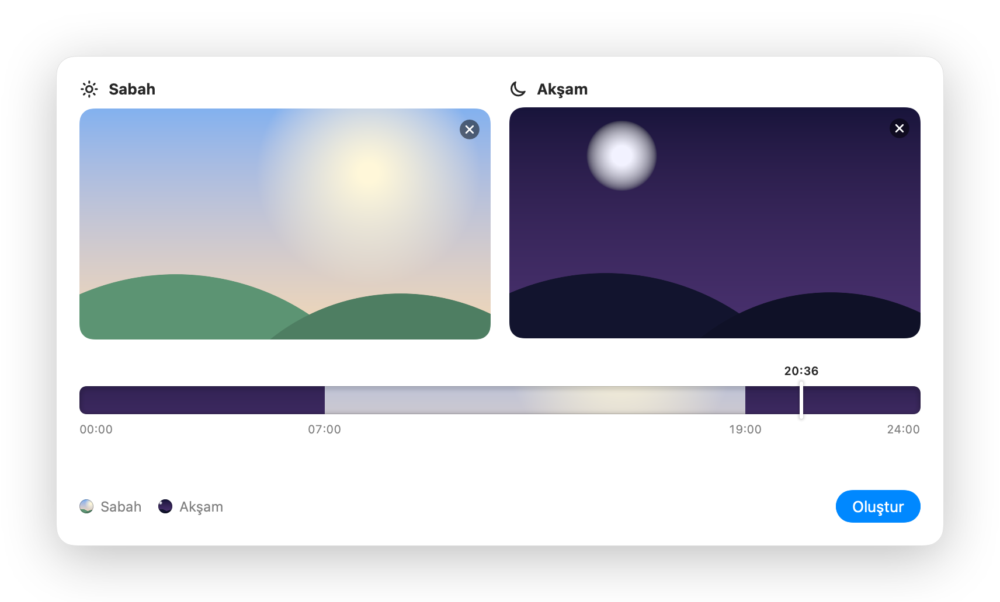
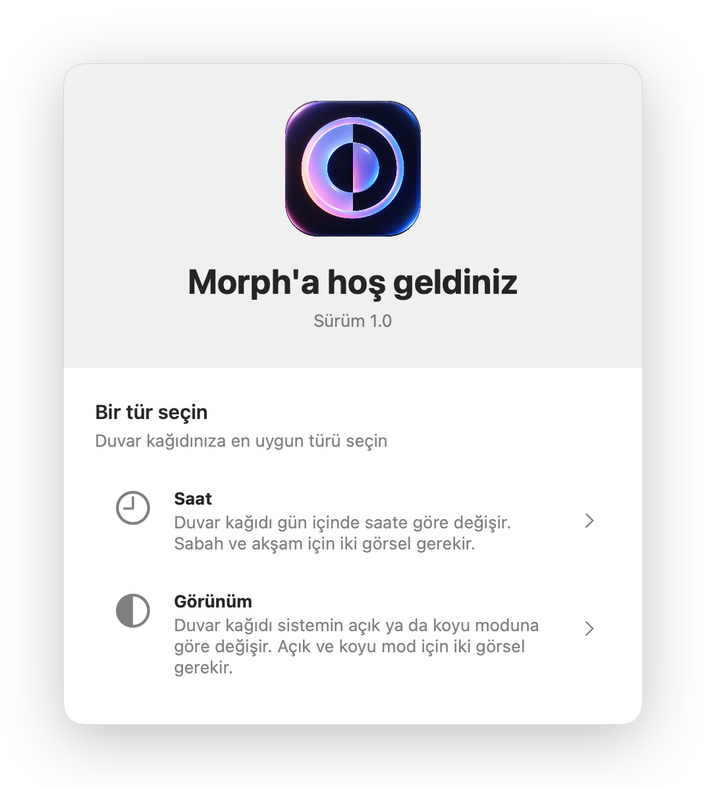
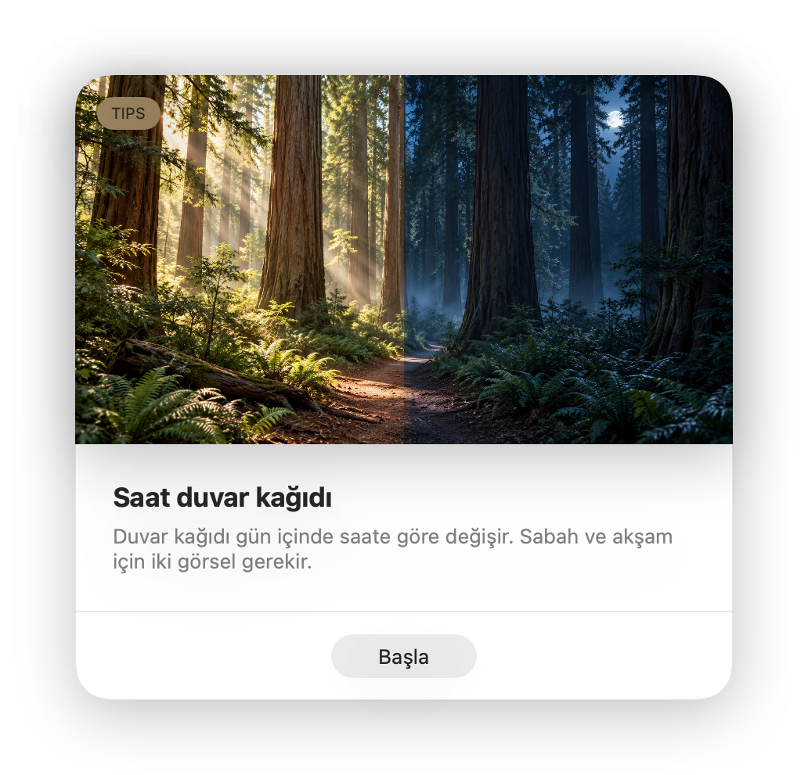
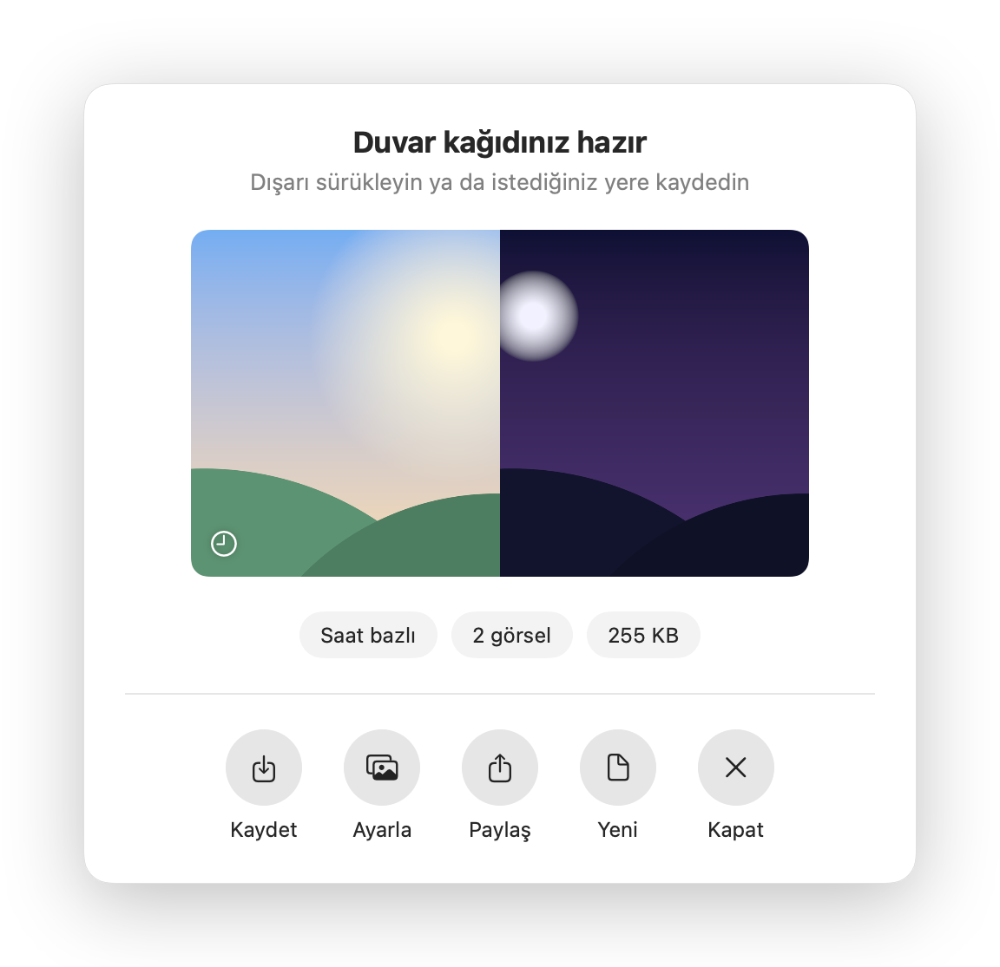
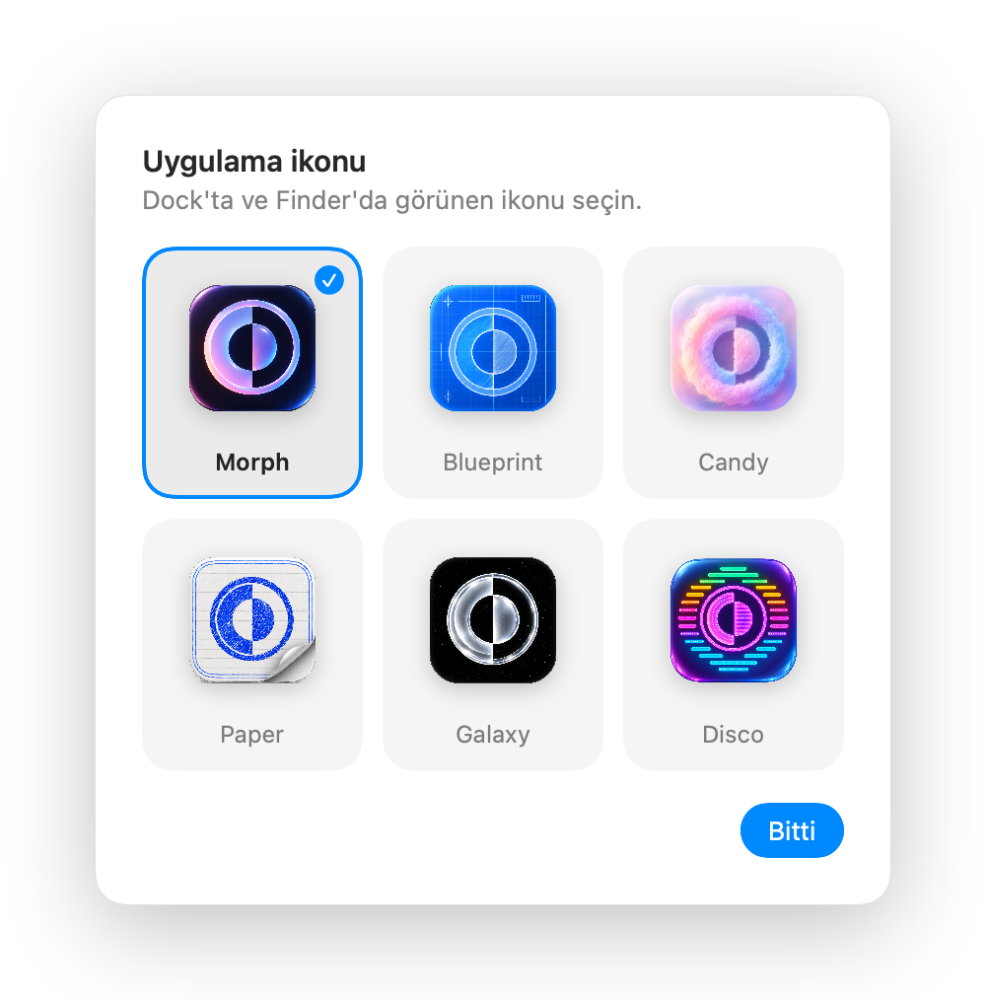
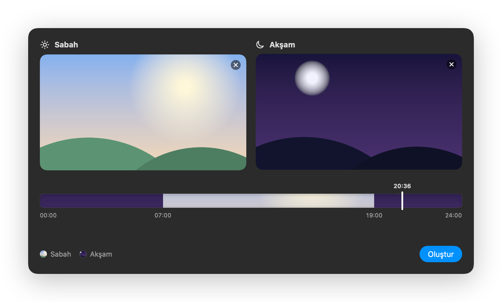

<p align="center">
  
</p>

<h1 align="center">Morph</h1>

<p align="center">
  Turn two images into a macOS dynamic wallpaper that changes with the time of day or with Light/Dark Mode.
</p>

<p align="center">
  
</p>

## What it does

Morph writes a single `.heic` file that macOS's own Dynamic Desktop reads. Nothing keeps running in the background: macOS switches the picture itself.

- **Time wallpaper:** a morning image from 07:00 and an evening image from 19:00. A timeline shows which picture is on screen at each hour.
- **Appearance wallpaper:** one image for Light Mode and one for Dark Mode.
- Drag and drop or pick PNG, JPEG, TIFF or HEIC files.
- When the file is ready, save it, set it as the wallpaper on every display, share it, or drag it out.
- Six app icons to choose from in Settings.

The interface is in Turkish.

## Screenshots

| Pick a kind | Tips |
| --- | --- |
|  |  |
| **Result** | **App icons** |
|  |  |

<p align="center">
  
</p>

## Requirements

- macOS 15 or later
- Xcode to build (developed with Xcode 27)

## Build

```sh
git clone https://github.com/yucesoymert/Morph.git
cd Morph
open Morph.xcodeproj   # then Run (⌘R)
```

There are no dependencies: only SwiftUI, ImageIO and AppKit.

Generated wallpapers go to `~/Pictures/Morph/`.

## How the file works

A dynamic wallpaper is a multi-image HEIC. The first image carries XMP metadata in Apple's `apple_desktop` namespace (`http://ns.apple.com/namespace/1.0/`). The value is a binary property list, base64-encoded:

| Kind | Key | Contents |
| --- | --- | --- |
| Time | `h24` | `ti`: list of `{i: image index, t: fraction of the day}`; `ap`: `{l: light index, d: dark index}` |
| Appearance | `apr` | `{l: 0, d: 1}` |

macOS doesn't wrap the time list past midnight: before the first entry it shows the first image. So Morph pins `t: 0` to the last image, and the evening picture stays on screen until 07:00.

All of this lives in [`Morph/HEICWriter.swift`](Morph/HEICWriter.swift). A self-check writes a file and reads it back:

```sh
swiftc -o /tmp/heiccheck Morph/HEICWriter.swift Checks/main.swift && /tmp/heiccheck
```

## Credits

- [Equinox](https://github.com/rlxone/Equinox) by rlxone inspired the Tips cards and the result screen.
- [wallpapper](https://github.com/mczachurski/wallpapper) by mczachurski is the reference for the HEIC metadata format.
- The README screenshots are rendered from the app's own views with generated sample images.

## License

Not yet chosen. Copyright © 2026 Mert Yücesoy. All rights reserved.
